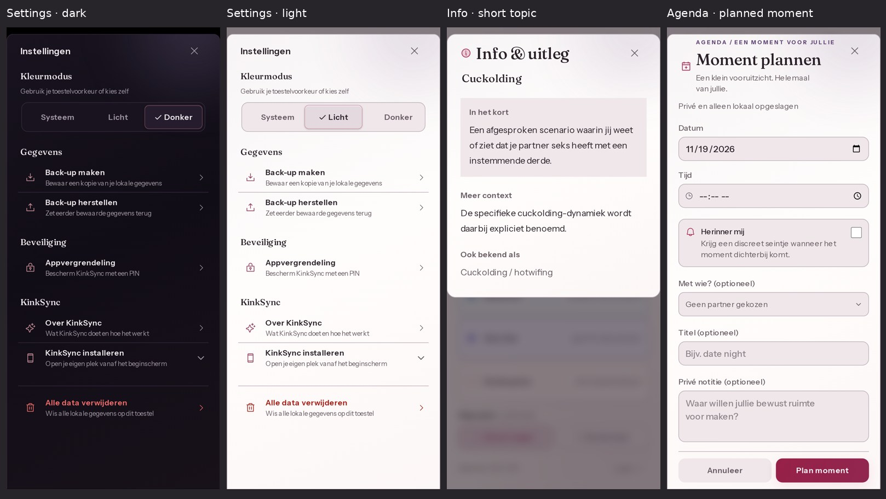

# KinkSync UX and motion audit

21 November 2026 · Planning review for `experiment/premium-motion` · Application baseline [dev at 38105b6](https://github.com/Jordybeer/kink/tree/38105b66419eab61dc75b8e2bc3e65164310904c)

**Decision.** Keep the Home and Profile information architecture, the aubergine and warm-paper themes, and the shared sheet. Change the composition of three overlays. Settings should make the current configuration easy to scan. Information should open on the subject and the answer. The moment composer should give the day, time and writing area priority. Fix the Settings focus handoff and two agenda editing paths before promoting new motion to production.

## What the evidence supports

The [baseline CI run](https://github.com/Jordybeer/kink/actions/runs/44611546563) passed. Its [visual rehearsal artifact](https://github.com/Jordybeer/kink/actions/runs/44611546563/artifacts/14576606221) contains 308 PNGs including repeated browser-project scenarios. I inspected representative rendered states across Home, Profile, filters, inline and private editing, Settings, status and topic help, the planned-moment form, questionnaire, Compare, contract, scene, share, deletion and About. I also inspected narrow/enlarged-text and desktop examples. The route and input findings below come from tracing the pinned implementation. The earlier audit and the existing [motion plan](../plans/2026-11-21-premium-motion.md) provide historical context. Current captures and source take precedence.

The screenshots show settled layouts. Device names in the archive identify CI configurations. Physical iPhone frame pacing, the iOS software keyboard, assistive technology announcements, actual perceived animation quality and installed-PWA restoration still need a live pass. The Superdesign sign-in timed out. The available MagicPath project had no KinkSync canvas. Neither supplied visual evidence for this review.

## Release priorities

P1 means the interaction can alter a record unexpectedly, lose a draft or put keyboard focus on the wrong surface. P2 means a material hierarchy or task-quality issue. P3 is bounded polish. A source-traced behavior is distinguished from an interaction reproduced on a device.

| Priority | Finding and evidence | Proposed change and acceptance |
|---|---|---|
| **P1** | **A partnerless moment can acquire the preferred partner on an unrelated edit.** Editing initializes a missing partner to an empty string. The shared picker interprets a Dutch placeholder as permission to set the preferred partner whenever the value is empty. Its menu offers profiles only. Saving writes the resulting partner ID and name. This requires a valid preferred partner and a save. [Picker](../../../components/ProfileSelect.tsx#L33) · [Draft initialization](../../../components/intimacy/IntimacyPlanner.tsx#L253) · [Persistence](../../../components/intimacy/IntimacyPlanner.tsx#L318) | Seed a preferred partner once when starting a new draft if that preference applies. Expose an explicit “Zonder partner” option in the optional picker. Edit only the note of an existing partnerless record, save and reopen. The partner must still be empty. An explicit clear must survive reopening. |
| **P1** | **One Escape can close the partner menu and the composer.** The listbox calls preventDefault and returns focus to its trigger. The enclosing sheet's window listener also closes on Escape without checking whether the key was handled. Reopening initializes the fields again. [Listbox](../../../components/ProfileSelect.tsx#L140) · [Sheet](../../../components/Sheet.tsx#L257) | Let the innermost open surface consume Escape. Type a note, open the picker and press Escape. The menu closes, the note stays, focus returns to its trigger. A second Escape invokes the existing composer dismissal. Verify opening with a keyboard as well as a pointer. |
| **P1** | **Settings → Appvergrendeling leaves focus ownership behind.** The PIN launcher keeps Settings open. The foreground PIN flow renders a fixed div without the shared dialog semantics, focus handoff or its own Escape handling. The Settings trap remains active for keyboard events within it. Backup export already closes Settings when handing off. This is an accessibility finding about operating the flow. [Launcher](../../../app/page.tsx#L599) · [PIN overlay](../../../components/sheets/PinFlowSheet.tsx#L60) · [Focus trap](../../../lib/useFocusTrap.ts#L19) | Give the PIN task one named, active dialog owner. Retain the originating Settings row and scroll position for return. Test configure/remove, Cancel, Tab, Shift+Tab and Escape. Background Settings controls must never receive keyboard input while the PIN task is in front. |
| **P2** | **Missing time is reported far from the field.** The fixed footer invokes validation. The alert sits after the private note, without an invalid state or description link on the affected input. A user can miss where to act when the sheet is scrolled. [Validation](../../../components/intimacy/IntimacyPlanner.tsx#L307) · [Time field](../../../components/intimacy/IntimacyPlanner.tsx#L538) · [Alert](../../../components/intimacy/IntimacyPlanner.tsx#L645) | Place the error beside date/time, link it programmatically and focus the first invalid field. Keep note, partner and reminder state. On a short phone with the keyboard open, the error and its field must be reachable and the primary action usable. |
| **P2** | **Topic help makes the reader read two titles.** “Info & uitleg” gets the largest heading. The subject comes second, followed by “In het kort” and then the definition. At 320 px and 200% text the generic heading wraps to two lines, the topic to several more, and only the opening of the definition is visible. The short example already fits its content. [Question help](../../../components/TriageDeck.tsx#L195) | Promote the real topic to the dialog title and put the definition directly after it. Leave aliases and extra context below. Keep a stable close target and the status explainer's distinct answer meanings. In the same enlarged-text fixture the first useful sentence must start higher and be reachable without scrolling past duplicate headings. |
| **P2** | **The planned-moment form assigns too much weight to the reminder.** Its tall tinted block precedes partner, title and private note. Small fields share similar visual weight. “Een klein vooruitzicht” also appears when logging a past moment. The existing bottom action is visible in the 390 px capture. [Composer](../../../components/intimacy/IntimacyPlanner.tsx#L488) | Lead the planned form with an editable day and time. Place an optional compact reminder after the personal details. In logging mode bring the title and note forward, make the date easy to reach, and keep time optional. Use one continuous form, its local-storage explanation and one primary commit. |
| **P2** | **The profile magnifier and five filters imply a different scope from the action.** In the light phone capture the magnifier sits beside “Interesses & grenzen”. Its action replaces the reading view with the entire catalogue. The filters beneath resemble a summary table. Their touch targets, accessible names, persistent boundary section and selected underline are worth retaining. [Profile](../../../components/profile/ProfileScreen.tsx#L519) | Give the catalogue launcher visible wording such as “Zoek in catalogus”. Preserve the five explicit statuses, counts, wrapping and pressed semantics. Give only the selected row a stable check or inset underline. A user should be able to predict the search scope before opening it and return to the same place afterwards. |
| **P2** | **The local private reveal has lost its transition on the compact reading row.** That row passes the plain variant, which keeps the same button and disables the keyed entrance. Replacing the entire row would risk focus and editor stability. [Profile row](../../../components/profile/ProfileTopicRow.tsx#L65) · [Status control](../../../components/PrivateResponseStatus.tsx#L68) · [Earlier reveal](https://github.com/Jordybeer/kink/commit/65598b0) | Keep the button stable. Prototype a neutral matte edge moving across the status lane after disclosure is permitted. Hide removes the actual label immediately, including from accessible names and decorative layers. Use a synthetic record and test Reveal → Hide mid-motion, then reopen. Preserve export and shared-view exclusions. |
| **P3** | **Profile atmosphere can differ after an offline navigation.** The matcher recognizes a pathname beginning with /profile/ but the cached document may use /profile with a query ID. [Matcher](../../../lib/ambientGlow.ts#L3) · [Offline navigation](../../../components/OfflineCacheWarmup.tsx#L72) | Give the two URL shapes the same profile atmosphere. Keep hard navigation and state restoration intact. Compare a direct cached entry and the corresponding warm profile with reduced motion on. |

## Visual direction by surface

| Surface | Keep | Change worth rehearsing |
|---|---|---|
| Home → Profile | Flat rows, names, portraits, linked perspectives and separate overflow actions. The pale Home capture already gives the two-person comparison its own identity. | Use the selected person's name, portrait and lower rule to carry the eye to the hero. For a linked perspective, follow the selected role. Another person's row and private hero details never join the moving layer. |
| Settings | Gegevens, Beveiliging and KinkSync are already distinct groups. Rows have descriptions, clear endpoints and a visually separate destructive action. | Give the theme selector one distinctive detail: a small sample of actual paper and ink per mode. Show selection with the existing check and keyboard focus with a separate outer ring. Keep utility icons quiet and keep all configuration within one direct opening. |
| Info and status help | The status explainer already reads well as a glossary. Curiosity has its own separated definition. Short help already sizes to content. | Give a topic its own heading, quiet paper and a continuous reading column. Keep the semantic marks in status definitions. For 200% text, allow the subject to scroll with the article if necessary while keeping Close reachable. |
| Agenda | Native date/time, privacy copy, separate calendar export and existing footer. | Give “when” a visual anchor in planning and give writing room in logging. Keep the privacy explanation beside the private note. Save gets the primary color and a little more width. Cancel stays easy to reach. |
| Profile editor | Inline answer changes, nearby safety context, tabular counts and pinned hard limits. | Keep the edited row in place until the user finishes. Move an indicator inside a stable target. Let a wrapping list settle once per filter change. Keep rapid typing and immediate saving independent of any timeline. |
| Compare and agreements | The sampled filtered Compare view still names the visible one-sided hard limit and explains the absence of a second answer. The contract already has an explicit pair and separate safeword fields. | Keep consent wording and inputs still while changing filters or scene atmosphere. Preserve the relationship thread for two-person meaning. Leave the long-form agreement a reading and editing surface. |
| Questionnaire and sharing | Named statuses, separate curiosity, a dashed hard-limit treatment, manual QR controls, and explicit local-data copy. About has a clear editorial hierarchy that can inform topic help. | Apply the help revision at its trigger. Keep repeated answers immediately available. QR movement remains controlled by the user. Preserve on-device and export semantics through the modal refactor. |
| Scenes, navigation and recovery | The setlist has an explicit added check and count. Scene fields and bottom actions carry distinct responsibilities. Error and missing-route components already expose recovery actions. | Blend a single background field on meaningful scene changes. Safeword, limits, aftercare and readiness text must remain stable and readable. Do not delay navigation, Retry, the offline shell or unlock for an exit animation. First-run, recovery and destructive flows get targeted regression coverage when their shared shell changes. |

## Color and rendering

The dark sheet is aubergine and the light one is warm paper. Both already belong to KinkSync. The larger gain is giving each color a narrower job. Use ink for reading, rose for the primary action, lavender for identity and focus, and existing status colors with their labels and glyphs. Keep concealed answers neutral. Use destructive styling only where the operation warrants it. Keep ordinary dividers quiet.

| Computed solid token pair | Dark | Light | Interpretation |
|---|---:|---:|---|
| Sheet / field fill | 1.06:1 | 1.20:1 | Fills alone provide little separation. |
| Current generic border / field fill | 1.31:1 | 1.75:1 | On date/time and note, the boundary can be hard to locate at a glance. |
| Existing control border / field fill | 3.55:1 | 3.68:1 | A stronger existing choice for essential field edges. |
| Secondary ink / field fill | 6.53:1 | 5.38:1 | Muted ink already provides real hierarchy on these two solid backgrounds. |

Values use relative luminance from [the theme tokens](../../../app/design-role-tokens.css). They are design inputs. Verify the actual blended pixels in focused, invalid and selected states. An ordinary decorative separator and an essential input indicator serve different purposes. [W3C non-text contrast](https://www.w3.org/WAI/WCAG22/Understanding/non-text-contrast.html)

The shared surface already uses a static 38 px highlight blur and a full-screen 8 px backdrop blur. The surface entrance uses the same 12 px travel for several jobs. Adding more blur to fix flatness would spend paint on the least informative layer. For the lab compare unchanged scrim, then a cheaper solid scrim, with identical foreground choreography. Numeric frame budgets and blend checks are in the [motion plan](../plans/2026-11-21-premium-motion.md). No trace in this audit establishes either a performance regression or a measured 120 Hz result. [Frame](../../../components/Sheet.tsx#L138) · [Backdrop](../../../components/SheetBackdrop.tsx#L5) · [Atmosphere](../../../app/modal-editorial.css)

## Quality verdict

Scores express evidence available at this baseline. 0 means absent, 2 means a working foundation with a material gap, and 4 requires strong behavior verified in the target context.

| Dimension | /4 | Reason |
|---|---:|---|
| Accessibility | 2 | Named choices, focus indicators and a reusable dialog exist. The PIN handoff, nested Escape and validation need work. |
| Performance readiness | 2 | Motion policy and bounded primitives exist. The expensive modal layers and proposed signature still need real-device traces. |
| Responsive behavior | 3 | The current 390 px captures and 320 px enlarged-text variants retain a coherent structure. Duplicate headers cost reading space. Live software-keyboard geometry is open. |
| Theming | 3 | Two authored themes and meaningful status roles are present. Form boundaries and the differing jobs of overlays deserve more contrast and emphasis. |
| Implementation integrity | 2 | The shell and inline editor are reusable. Picker defaults and overlay ownership cross component boundaries. |
| **Overall** | **12/20** | **Proceed with isolated R&D. Resolve the three P1 interaction defects before production adoption.** |

The general design scan raised six leads. A bounded questionnaire width animation and an unnecessary padding transition are profiling or cleanup candidates. A semantic rail on Compare and a selected-role indicator have actual meaning. An onboarding border is a minor visual choice. The contract-preview image receives its source in an effect. None of these outranks the three source-traced interaction defects.

## Implementation and acceptance sequence

1. **Correct behavior in a narrow follow-up, estimated 1–2 engineering days.** Separate the picker default from rendering and give the active overlay exclusive keyboard ownership. Check the three P1 paths and field-level validation. Reuse the existing agenda, Settings and device-overlay suites. Current phase delivers planning and evidence.
2. **First flagship experiment, estimated 2–3 days.** Build `/hot` → `/hot/profile/[id]` in the real gated shell. On a 390 px screen the source row's lower rule opens, the portrait moves along the margin and the same name resolves into its heading. Compare immediate navigation with one WAAPI-owned presentation layer. Try halfway Back, a second profile, linked perspectives, slow loading and app switch. The URL, scroll, focus and actual profile must agree after each interruption. Reduced motion gets immediate navigation.
3. **First modal study, estimated 1–2 days.** Use the real moment composer with synthetic records. Compare the present layout with the revised one at rest in both themes. Ask the reviewer to point to when, where to write and how to save. Open the keyboard, submit missing time, clear a partner, expand a reminder and switch to logging. Review a short topic sheet and Settings alongside it. A user should recognize each task with its title covered.
4. **One bounded visual and device review.** Capture forward, midpoint, reverse and interrupted states. Check baseline alignment, duplicate text, clipping, layer order and any light frame between dark surfaces. Check 320 px/200% text, keyboard-only focus, reduced motion during travel, actual iPhone Safari and standalone PWA. Measure a warm control and the candidate at the display's observed refresh rate. Target first feedback p95 ≤50 ms, at least 95% of available frame slots, and no motion-attributable stall over 50 ms. Record device, refresh, sample size and frame intervals. Do one correction pass and recheck the changed cases.
5. **Production decision.** Keep existing Motion and CSS for local controls. Try lazy GSAP only against the same choreography if WAAPI authoring or interruption proves limiting. Choose using the visible midpoint, input response, reversal, bundle and trace. Port the approved interaction in a fresh, narrowly scoped PR to dev. Keep the prototype fixtures, tooling, captures and alternative engines on the experiment branch.

[Modal interaction reference](https://www.w3.org/WAI/ARIA/apg/patterns/dialog-modal/) · [Error identification](https://www.w3.org/WAI/WCAG22/Understanding/error-identification.html)

**Approval recommendation.** Approve the row-to-profile Open Folio experiment and the task-specific modal compositions. The first running prototype is one real profile transition, including a halfway reverse. The first modal prototype is the existing planned-moment form with the required time unmistakable and an explicit partnerless save.
